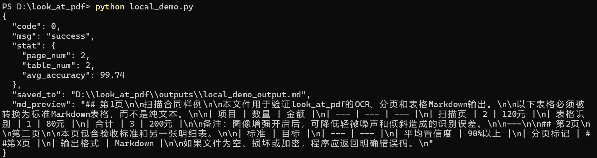

# look_at_pdf

把**扫描版 PDF 或图片**转成标准 Markdown，表格也还原成 Markdown 表格。

以 Python 函数直接调用，也可以作为 [MCP](https://modelcontextprotocol.io) 工具接入任意 MCP 客户端，让模型"看得见"本地扫描件。

## 效果

`samples/sample_scanned.pdf`（2 页、2 张表）的实测输出：

```json
{
  "code": 0,
  "msg": "success",
  "stat": { "page_num": 2, "table_num": 2, "avg_accuracy": 99.74 }
}
```

```markdown
## 第1页

扫描合同样例

本文件用于验证 look_at_pdf 的 OCR、分页和表格 Markdown 输出。

| 项目 | 数量 | 金额 |
| --- | --- | --- |
| 扫描页 | 2 | 120元 |
| 表格识别 | 1 | 80元 |
| 合计 | 3 | 200元 |

---

## 第2页
...
```



## 它解决什么

扫描件没有文字层，`pdftotext` 之类直接抽取只会得到空白；文字必须靠 OCR，表格线框要靠视觉重建。本项目把这条链路固定下来：

```text
PDF / 图片
-> 220 DPI 渲染成页面图（PyMuPDF）
-> 去噪、CLAHE 增强、轻微倾斜矫正（OpenCV）
-> OCR 得到文字 + 置信度 + 坐标（RapidOCR / ONNX）
-> 线框检测 + 文字坐标归位，重建表格（OpenCV）
-> 按页输出 Markdown，页间用 --- 分隔
```

本地函数和 MCP 工具共用同一个入口 `convert_to_markdown()`，返回同一份 JSON，行为一致。

## 安装

```powershell
pip install -r requirements.txt
```

依赖偏重（PyMuPDF、OpenCV、onnxruntime 合计数百 MB）。**首次运行 OCR 时 RapidOCR 会自动下载 ONNX 模型**（约 15 MB），需要联网。

## 用法

### 1. 作为 Python 函数

```python
from look_at_pdf import convert_to_markdown

result = convert_to_markdown(
    file_path="samples/sample_scanned.pdf",
    enhance_img=True,
    fix_table=True,
)
print(result["code"], result["stat"])
print(result["md_content"])
```

直接跑内置演示：

```powershell
python local_demo.py
```

### 2. 作为 MCP 服务

```powershell
python mcp_server.py --port 8001
```

服务地址 `http://127.0.0.1:8001/mcp`（streamable-http），注册的工具名是 `look_at_pdf`。
端口被占用时进程以错误码 `1007` 退出，并在 stderr 打印结构化 JSON。

### 3. MCP 客户端演示

```powershell
python mcp_client_demo.py --url http://127.0.0.1:8001/mcp
```

## 参数

| 字段 | 类型 | 默认 | 说明 |
| --- | --- | --- | --- |
| `file_path` | string | 必填 | 本地文件路径，支持 `.pdf` 与 `.png` `.jpg` `.jpeg` `.tif` `.tiff` `.bmp` `.webp` |
| `enhance_img` | bool | `true` | 开启去噪、CLAHE 增强与轻微倾斜矫正 |
| `fix_table` | bool | `true` | 自动补齐和矫正错位表格 |

## 返回结构

| 字段 | 类型 | 说明 |
| --- | --- | --- |
| `code` | int | `0` 成功，非 `0` 见错误码 |
| `msg` | string | 执行信息或错误原因 |
| `md_content` | string | 完整 Markdown；失败时为空字符串 |
| `stat.page_num` | int | 页数 |
| `stat.table_num` | int | 识别到的表格数 |
| `stat.avg_accuracy` | float | OCR 平均置信度（百分比）。**这是引擎置信度，不是人工标注准确率** |

## 错误码

| code | 含义 |
| --- | --- |
| 0 | 成功 |
| 1001 | 文件不存在 |
| 1002 | 文件类型不支持 |
| 1003 | PDF 已加密 |
| 1004 | 文件损坏或无法读取 |
| 1005 | 空白 PDF 或未识别到内容 |
| 1006 | OCR 后端不可用（未安装依赖） |
| 1007 | MCP 服务端口被占用 |
| 1999 | 未知异常 |

所有异常都会被翻译成结构化返回值，`convert_to_markdown()` 不向外抛异常。

## 目录结构

```text
look_at_pdf/
  __init__.py     公开入口
  converter.py    串联整条流程，统一返回结构
  renderer.py     PDF / 图片 -> 页面图（220 DPI）
  preprocess.py   去噪、增强、矫偏
  ocr.py          RapidOCR 适配层
  table.py        线框表格检测与 Markdown 渲染
  markdown.py     按页拼装 Markdown
  schemas.py      请求 / 返回数据结构
  errors.py       错误码定义
mcp_server.py     MCP 服务
mcp_client_demo.py MCP 客户端演示
local_demo.py     本地函数演示
samples/          测试样本（空白 / 损坏 / 加密 / 扫描件）
scripts/          生成样本与截图的脚本
demo/             演示输出与截图
skills.md         工具契约（入参、返回、错误码）
```

## 测试样本

| 文件 | 用途 |
| --- | --- |
| `samples/sample_scanned.pdf` | 正常扫描件，2 页 2 表 |
| `samples/blank.pdf` | 触发 1005 |
| `samples/encrypted.pdf` | 触发 1003 |
| `samples/damaged.pdf` | 触发 1004 |

## 已知局限

- OCR 使用 RapidOCR 默认模型，中英文印刷体效果好；**手写体、艺术字、竖排文字**识别率明显下降。
- 表格检测基于**线框**，无边框表格不会被重建，会退化为普通文本行。
- 版面按"从上到下、从左到右"线性输出，多栏排版、图文混排的阅读顺序可能不准。
- 整页 220 DPI 渲染 + OCR，一页通常需要数秒，不适合批量处理几百页的文档。
